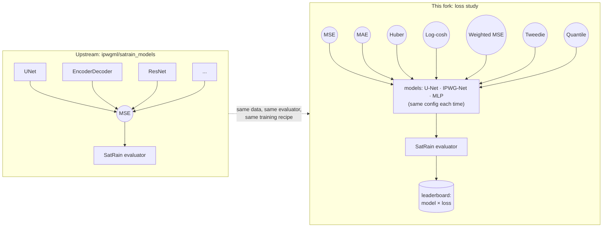
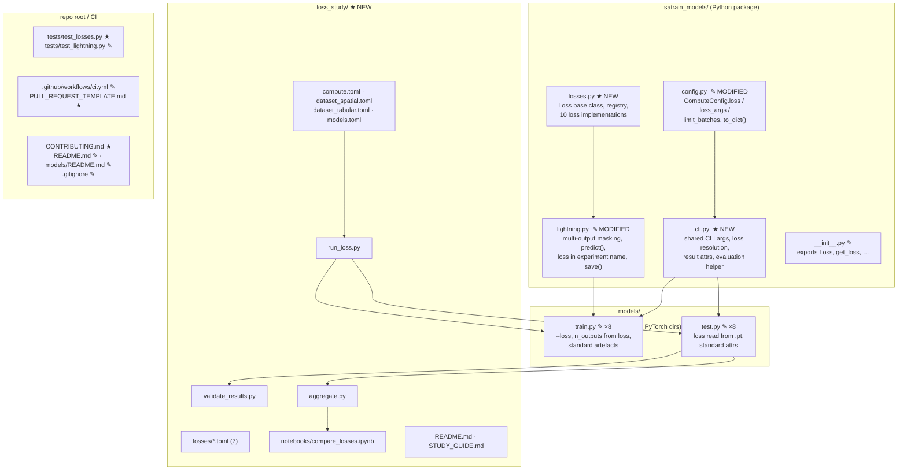
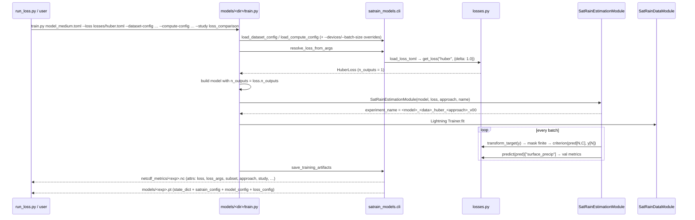
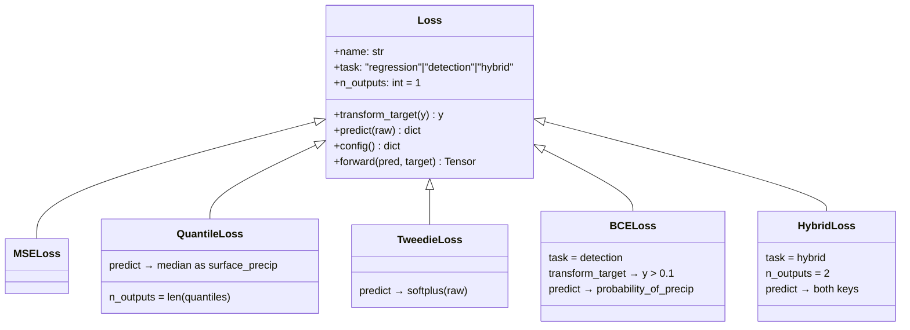
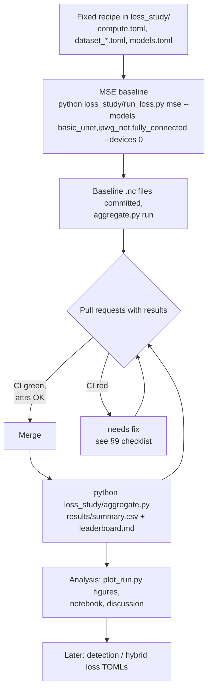
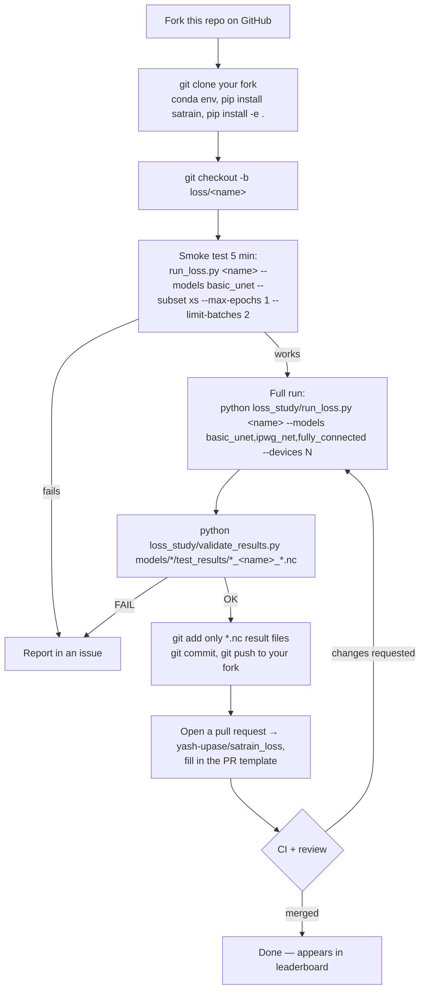
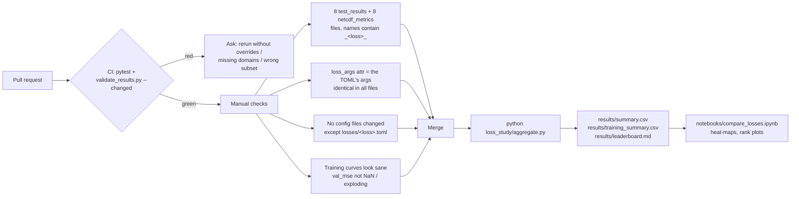

# satrain_loss — SatRain Loss-Function Comparison Study: Complete Guide

*Reference: what changed relative to `satrain_models`, how the study runs, and how results are produced and collected.*

---

## Table of contents

1. [Purpose in one picture](#1-purpose-in-one-picture)
2. [The reference repo vs. this fork](#2-the-reference-repo-vs-this-fork)
3. [What was changed — file by file](#3-what-was-changed--file-by-file)
4. [How it works under the hood](#4-how-it-works-under-the-hood)
5. [The fixed experimental protocol](#5-the-fixed-experimental-protocol)
6. [Maintaining the study](#6-maintaining-the-study)
7. [Running a loss and submitting results](#7-running-a-loss-and-submitting-results)
8. [Study summary](#8-study-summary)
9. [Reviewing submissions and building the leaderboard](#9-reviewing-submissions-and-building-the-leaderboard)
10. [Phase 2 (detection) and phase 3 (hybrid)](#10-phase-2-detection-and-phase-3-hybrid)
11. [Command reference](#11-command-reference)

---

## 1. Purpose in one picture

The upstream repository `ipwgml/satrain_models` compares **architectures** on the SatRain benchmark with one fixed loss (MSE). This fork flips the experiment: every architecture is held fixed and the **loss function** becomes the variable.



Result: a **model × loss** matrix scored with identical metrics, so you can answer both "which loss is best for a given model?" and "is the ranking of losses stable across models?".

> **Current focus.** As decided in the meeting, the analysis currently focuses on three models: `basic_unet` (U-Net), `ipwg_net` (IPWG-Net) and `fully_connected` (pixel-wise MLP). The commands in this guide select them with `--models basic_unet,ipwg_net,fully_connected`; the other models in `models.toml` can be run the same way. Together they span the main design choices: a plain CNN (U-Net), a deeper residual encoder–decoder (IPWG-Net) and a pixel-wise model without spatial context (MLP), giving a 3 × 7 = 21-run matrix.

---

## 2. The reference repo vs. this fork

| | Upstream `ipwgml/satrain_models` | This fork |
|---|---|---|
| Variable under study | architecture | **loss function** |
| Loss | hard-coded `nn.MSELoss()` in every `train.py`/`test.py` | selected by name/TOML/CLI from a **registry** (`satrain_models/losses.py`) |
| Model output width | hard-coded `n_outputs=1` | `loss.n_outputs` (quantile → 5 channels, hybrid → 2) |
| Where the loss meets the model | `SatRainEstimationModule` flattens pred/target to 1-D and calls the loss | generalised: multi-channel outputs, target transforms, link functions, named outputs (`predict`) |
| Experiment names | `<model>_<dataset>_<approach>_vNN` | `<model>_<dataset>_<loss>_<approach>_vNN` |
| Result-file metadata | model info only | + `loss`, `loss_args`, `loss_task`, `subset`, `geometry`, `approach`, `max_epochs`, `study` |
| Test-time loss | re-hard-coded MSE | read back from the saved `.pt` (so quantile/Tweedie outputs are decoded correctly) |
| Compute config | one `compute.toml` per model dir, inconsistent (1 vs 100 epochs, different precisions) | one **shared** `loss_study/compute.toml` for the study; per-dir files untouched for other uses |
| Dataset config | `subset = "xl"` per dir | shared `loss_study/dataset_spatial.toml` / `dataset_tabular.toml`, `subset = "m"` |
| Running many experiments | shell scripts per dir | `loss_study/run_loss.py <loss>` runs train + test on all models |
| Comparing results | hand-written notebook loading files one by one | `loss_study/aggregate.py` → CSV + Markdown leaderboard; notebook reads the CSV |
| Contribution checks | none | `validate_results.py` in CI, PR template, `CONTRIBUTING.md` |
| Bugs fixed along the way | — | undefined names in `efficient_net_v2/{train,test}.py`, broken import in `dense_encoder_decoder/test.py`, convnext `test.py` evaluated only Austria, UNet `bilinear` train/test mismatch, LR schedulers crash on tiny runs |

Everything upstream still works: `python train.py …` with no `--loss` trains with MSE exactly as before (only the file name gains `_mse_`).

---

## 3. What was changed — file by file



### 3.1 `satrain_models/losses.py` (new)

| Symbol | Purpose |
|---|---|
| `class Loss(nn.Module)` | Base class. Attributes `name`, `task` (`regression` / `detection` / `hybrid`); hooks `n_outputs`, `transform_target(y)`, `predict(raw) → dict`, `config() → {"name", "args"}`. |
| `@register_loss("name")`, `LOSSES` | Registry. |
| `get_loss(name, args)` | Instantiate by registered name **or** dotted import path (`my_pkg.MyLoss`). |
| `load_loss_toml(path)`, `resolve_loss(spec)` | TOML → loss; accepts name / path / `Loss` / plain `nn.Module`. |
| `TorchLossAdapter` | Wraps any plain `nn.Module` loss (back-compat for `nn.MSELoss()`). |

Losses available in the study (`loss_study/losses/`):

| name | formula / behaviour | `n_outputs` | args |
|---|---|---|---|
| `mse` | mean squared error (baseline) | 1 | – |
| `mae` | mean absolute error | 1 | – |
| `huber` | quadratic below `delta`, linear above | 1 | `delta=1.0` |
| `logcosh` | `mean(log cosh(e))`, numerically stable form | 1 | – |
| `weighted_mse` | `Σ w·e² / Σ w`, `w = 1+α·y` (`linear`) or `1+α·[y>thr]` (`step`) | 1 | `alpha=1.0, threshold=0.1, mode="linear"` |
| `tweedie` | Tweedie deviance, `μ = softplus(out)`; `predict` applies the same link | 1 | `p=1.5, eps=1e-6` |
| `quantile` | pinball loss, one channel per quantile; `predict` returns the median as `surface_precip` (+ all quantiles) | `len(quantiles)` | `quantiles=[0.05,0.16,0.5,0.84,0.95]` |

### 3.2 `satrain_models/lightning.py` (modified)

* `SatRainEstimationModule(loss=…)` accepts a `Loss`, a name, a TOML path or a plain module.
* `_compute_finite_loss`: mask on finite **targets**, gather prediction channels channel-last → loss receives `(N, C)` (or `(N,)` for single-output). Works for spatial `(B,C,H,W)` and tabular `(B,C)`.
* `training_step` / `validation_step`: apply `loss.transform_target`; validation metrics (`val/mse`, `val/mae`, `val/bias`, `val/corrcoef`) are computed on `loss.predict(...)["surface_precip"]`, so they are comparable across losses.
* `get_retrieval_fn`: raw model output → `loss.predict` → dict → existing evaluator path (`surface_precip`, `probability_of_precip`, …).
* `experiment_name` = `<name>_<loss>_<approach>_vNN`, fixed once chosen (previously it could silently bump the version between training and saving).
* `save()` writes `loss_config` (and optional `model_config`) into the `.pt`.
* LR-scheduler step counts guarded (`max(1, …)`) so smoke runs with 1–2 steps don't crash.

### 3.3 `satrain_models/cli.py` (new)

Shared by all 16 scripts:

| function | role |
|---|---|
| `add_common_args(parser, testing=False)` | `--dataset-config --compute-config --loss --loss-arg --devices --precision --max-epochs --batch-size --limit-batches --study` |
| `load_dataset_config`, `load_compute_config` | TOML loading + CLI overrides |
| `resolve_loss_from_args` | precedence: `--loss` > `compute.toml [loss]` > `mse` |
| `load_saved_model` | reads `.pt`/`.ckpt`, strips Lightning prefixes, returns `state_dict`, `satrain_config`, `model_config`, `loss_config` |
| `run_evaluation` | evaluates on `austria, conus, korea` |
| `result_attrs` | the standard NetCDF attribute set |
| `save_training_artifacts` | writes `netcdf_metrics/<exp>.nc` and `models/<exp>.pt` |
| `save_test_results` | writes `test_results/<exp>.nc` |

### 3.4 `models/<dir>/train.py` and `test.py` (8 × 2 modified)

Same 4-line pattern in each `train.py`:

```python
add_common_args(parser); args = parser.parse_args()
loss = resolve_loss_from_args(args, compute_config)
model = create_xxx(..., n_outputs=loss.n_outputs)            # or model_config.out_channels = loss.n_outputs
SatRainEstimationModule(model=model, loss=loss, ...)
save_training_artifacts(...)                                  # metrics + .pt with loss_config
```

Each `test.py`: `loss = get_loss(**saved["loss_config"])`, rebuild the model with `loss.n_outputs`, evaluate, write attrs. The result file is named after the model file (`test_results/<model-file-stem>.nc`), so train and test artefacts always match.

### 3.5 `loss_study/` (new) — see sections 5–9.

### 3.6 Tests / CI / docs

* `tests/test_losses.py` — 55 tests: masking & gradients for every registered loss (spatial + tabular), predict shapes, config round-trip, formula checks, registry, TOML, experiment naming, `.pt` round-trip.
* `tests/test_lightning.py` — new parametrised test: quantile / tweedie / hybrid train 2 batches and evaluate one scene through the real evaluator.
* `.github/workflows/ci.yml` — runs pytest, then `validate_results.py --changed` on PRs.
* `.github/PULL_REQUEST_TEMPLATE.md`, `CONTRIBUTING.md`, README updates, `.gitignore` (`lightning_logs/`, `models/*/models/`, `loss_study/logs/`, `loss_study/.tmp/`).

---

## 4. How it works under the hood

### 4.1 One training run



### 4.2 One evaluation run

```mermaid
sequenceDiagram
    participant U as run_loss.py / user
    participant T as models/<dir>/test.py
    participant C as satrain_models.cli
    participant M as SatRainEstimationModule
    participant E as satrain.evaluation.Evaluator
    U->>T: test.py models/<exp>.pt --compute-config … --study loss_comparison
    T->>C: load_saved_model → loss_config, model_config, satrain_config
    T->>T: loss = get_loss(**loss_config); rebuild model with loss.n_outputs; load weights
    loop austria, conus, korea
        T->>E: evaluate(retrieval_fn)
        E->>M: retrieval_fn(scene)
        M->>M: raw output → loss.predict → {"surface_precip": …}
        M-->>E: xarray.Dataset
    end
    T->>C: save_test_results → test_results/<exp>.nc (bias, mae, mse, smape, corr, POD/FAR/HSS, … × 3 domains + attrs)
```

### 4.3 The `Loss` contract (what makes phases 2/3 free)



The evaluator already understands `surface_precip` (regression metrics) and `probability_of_precip` (detection metrics), so a loss only has to say what its channels mean.

---

## 5. The fixed experimental protocol

**Only the loss varies.** Everything else is pinned in `loss_study/` and identical for every run.

| Setting | Value | File |
|---|---|---|
| Sensor / geometry (CNNs) | GMI, gridded, spatial 256×256 tiles | `dataset_spatial.toml` |
| Sensor / geometry (MLP) | GMI, on-swath, tabular | `dataset_tabular.toml` |
| Training subset | **`m`** | both dataset TOMLs |
| Optimiser / schedule | `adamw_warmup_cosine_annealing_restarts` (repo's tuned default LR) | `compute.toml` |
| Epochs | **`max_epochs = 100`** | `compute.toml` |
| Precision | `bf16-mixed` | `compute.toml` |
| Batch size | per model (memory bound, verified on a 12 GB GPU), identical across losses | `models.toml` |
| Model size | one per architecture | `models.toml` |
| Evaluation | full SatRain test set, domains Austria / CONUS / Korea | `test.py` |

Model matrix (`models.toml`); the models currently analysed (see §1) are listed first:

| model dir | config used | batch | format |
|---|---|---|---|
| `basic_unet` | built-in U-Net | 32 | spatial |
| `ipwg_net` | `ipwg_net.toml` | 8 | spatial |
| `fully_connected` | `model_medium.toml` (MLP 128×128×128) | 16384 | tabular |
| `encoder_decoder` | `model_unet_medium.toml` | 16 | spatial |
| `dense_encoder_decoder` | `model_resnext_d2.toml` | 4 | spatial |
| `efficient_net_v2` | `model_medium.toml` (pretrained) | 32 | spatial |
| `convnext` | `model_small.toml` (pretrained) | 32 | spatial |
| `ResNet` | `model_medium.toml` | 4 | spatial |

Loss list (`loss_study/losses/*.toml`):

`mse` (baseline) · `mae` · `huber` · `logcosh` · `weighted_mse` · `tweedie` · `quantile`

A run is only accepted into the leaderboard if its result files carry `study = "loss_comparison"`, `subset = "m"`, the fixed `approach`, `max_epochs = 100` and all three domains — `validate_results.py` checks this (§9), and `aggregate.py` leaves out runs made under any other setting.

---

## 6. Maintaining the study

The shared parts of the study — the fixed recipe, the baseline, reviewing pull requests and the leaderboard — follow this cycle:



### The repository

The study lives at `https://github.com/yash-upase/satrain_loss`, a fork of `ipwgml/satrain_models` (kept as the `upstream` remote). Branch protection on `main` (require a pull request and passing CI) is what makes `validate_results.py` a real gate.

### The compute budget

`max_epochs = 100`, subset `m` and the per-model batch sizes are fixed for the whole study. Changing any of them would invalidate every finished run, so a change, if ever needed, is discussed in an issue and then applies to all runs.

### Baseline

```bash
pip install -e .                                   # make sure THIS checkout is what Python imports
python loss_study/run_loss.py mse --models basic_unet,ipwg_net,fully_connected --devices 0
python loss_study/validate_results.py models/*/test_results/*_mse_*.nc
git add models/*/test_results/*_mse_*.nc models/*/netcdf_metrics/*_mse_*.nc
git commit -m "Add MSE baseline results" && git push
```

---

## 7. Running a loss and submitting results



### Commands, verbatim

```bash
# 1. get the code
git clone https://github.com/<your-github-username>/satrain_loss.git   # your fork of yash-upase/satrain_loss
cd satrain_loss
conda create -n satrain_loss python=3.11 -y && conda activate satrain_loss
pip install git+https://github.com/ipwgml/satrain
pip install -e .

# 2. branch for the loss
git checkout -b loss/huber

# 3. smoke test (few minutes; downloads the tiny 'xs' subset)
python loss_study/run_loss.py huber --models basic_unet --subset xs --max-epochs 1 --limit-batches 2 --devices 0

# 4. the real thing (downloads subset 'm' + the test set on first use)
python loss_study/run_loss.py huber --models basic_unet,ipwg_net,fully_connected --devices 0   # train + test
#   or model by model / resume after a crash:
python loss_study/run_loss.py huber --models ipwg_net --devices 0
python loss_study/run_loss.py huber --models ipwg_net --skip-train    # re-run only evaluation

# 5. check
python loss_study/validate_results.py models/*/test_results/*_huber_*.nc

# 6. submit
git add models/*/test_results/*_huber_*.nc models/*/netcdf_metrics/*_huber_*.nc
git commit -m "Huber loss results (U-Net, IPWG-Net, MLP)"
git push -u origin loss/huber
# → GitHub: "Compare & pull request" against yash-upase/satrain_loss
```

Please **avoid**:

* editing `loss_study/compute.toml`, `dataset_*.toml`, `models.toml`, or any other loss's TOML;
* committing `.pt`, `checkpoints/`, `lightning_logs/` (git-ignored);
* submitting runs made with `--subset`, `--max-epochs`, `--limit-batches` or `--batch-size` overrides (they are tagged `loss_comparison_smoke` and rejected).

**Encouraged**:

* tuning the loss's `[args]` in `loss_study/losses/<loss>.toml` **before** starting, and including that file in the PR with a short explanation;
* implementing a *new* loss class if it isn't in the registry (see `CONTRIBUTING.md`): subclass `Loss`, `@register_loss`, add a TOML — no model file changes.

---

## 8. Study summary

> **SatRain loss-function comparison**
>
> Repo: `https://github.com/yash-upase/satrain_loss` (fork of ipwgml/satrain_models).
> Goal: train U-Net, IPWG-Net and a pixel-wise MLP with each of seven estimation losses (`mse`, `mae`, `huber`, `logcosh`, `weighted_mse`, `tweedie`, `quantile`) under an identical, fixed recipe, and compare the losses across models.
>
> **Steps**
> 1. Fork the repo, clone the fork, `pip install -e .`, and follow `loss_study/README.md` — a full run is one command: `python loss_study/run_loss.py <loss> --models basic_unet,ipwg_net,fully_connected --devices <gpu>`.
> 2. Do the 5-minute smoke test first (`--subset xs --max-epochs 1 --limit-batches 2`) to check the environment.
> 3. When the models are done, run `python loss_study/validate_results.py models/*/test_results/*_<loss>_*.nc`, commit **only** the `.nc` result files, and open a pull request to this repo using the template.
>
> **Ground rules (so results are comparable)**
> * Do not change `loss_study/compute.toml`, `dataset_*.toml`, `models.toml`. If a model doesn't fit on the GPU, or something should change (epochs, subset size, …), open an issue so that the change applies to every run.
> * A loss's `[args]` in `loss_study/losses/<loss>.toml` may be tuned *before* the run; the same args are used for all models and the choice is explained in the PR.
> * Subset `m`, 100 epochs, all three test domains. Runs with overrides are rejected automatically.
>
> Docs: `loss_study/WALKTHROUGH.md` (step-by-step example with `mae`), `loss_study/README.md` (protocol), `CONTRIBUTING.md` (adding a loss).

Good to know:

* *Why the loss owns its outputs*: quantile/Tweedie need extra channels or link functions; that logic lives in the `Loss` class, not in the model scripts — nobody needs to edit `train.py`.
* *What a "result" is*: two small NetCDF files per model (`test_results/…nc` = scores, `netcdf_metrics/…nc` = training curves), ~10 kB each.
* *What happens after a merge*: `aggregate.py` is re-run and the leaderboard in `loss_study/results/` is updated.

---

## 9. Reviewing submissions and building the leaderboard



Quick manual inspection of one file:

```bash
python - <<'EOF'
import xarray as xr, glob
for f in sorted(glob.glob("models/*/test_results/*_huber_*.nc")):
    ds = xr.open_dataset(f)
    a = ds.attrs
    print(f.split('/')[1], a["loss"], a["loss_args"], a["subset"], a["max_epochs"], a.get("study"),
          "mae:", ds.mae.values.round(3))
EOF
```

`aggregate.py` writes:

| file | content |
|---|---|
| `results/summary.csv` | long table: model × loss × domain × metric × value (+ `loss_args`, `num_parameters`, source file) |
| `results/training_summary.csv` | best/final `val_*` per run, epochs, wall-clock hours |
| `results/leaderboard.md` | per metric (`bias, mae, mse, smape, correlation_coef`, plus POD/FAR/HSS/AUC and heavy-rain variants): model × loss table averaged over domains, per-domain tables (collapsed), and **mean rank of each loss across models** |

`loss_study/results/` is committed after each merge — it is the study's live scoreboard.

---

## 10. Phase 2 (detection) and phase 3 (hybrid)

Not part of the current stage — to be added later. Nothing in the core needs to change: the `Loss` contract already carries `task`, `transform_target` and `predict`, and reference implementations (`bce`, `focal`, `hybrid`) exist in `satrain_models/losses.py` with tests; they are simply not exposed in `loss_study/losses/` yet.

```mermaid
flowchart LR
    P1["Phase 1 — regression<br/>7 losses, task=regression<br/>metrics: bias/mae/mse/corr"] --> P2["Phase 2 — detection<br/>bce, focal, (dice, tversky…)<br/>task=detection<br/>metrics: POD/FAR/HSS/AUC"]
    P2 --> P3["Phase 3 — hybrid<br/>regression + β·detection, 2 heads<br/>task=hybrid<br/>both metric groups"]
    P1 -. same runner, validator,<br/>aggregate.py --task … .-> P3
```

To start phase 2: add `loss_study/losses/<name>.toml` with `task = "detection"` (and a `Loss` subclass if new), run `run_loss.py <name>` exactly as before, and aggregate with `python loss_study/aggregate.py --task detection`. For hybrid, `--task hybrid` reports both metric groups.

Note for phase 2: `SatRainDetectionModule` from upstream is still there but no longer needed; the base module + a detection `Loss` does the same job with all the study plumbing.

---


## 11. Command reference

```text
# study runner
python loss_study/run_loss.py <loss> [--models a,b] [--devices 0 | 0,1 | cpu] [--skip-train] [--skip-test] [--dry-run]
                                     [--subset xs] [--max-epochs N] [--limit-batches N] [--batch-size N] [--precision 32]   # ← smoke-test only
# validate / aggregate
python loss_study/validate_results.py models/*/test_results/*_<loss>_*.nc   [--changed] [--lenient]
python loss_study/aggregate.py [--all] [--task regression|detection|hybrid] [--output DIR]

# a single model by hand (inside models/<dir>/)
python train.py <model.toml> --loss huber --loss-arg delta=0.5 --devices 1 [--dataset-config …] [--compute-config …] [--study TAG]
python test.py models/<experiment>.pt --devices 1 [--study TAG]

# tests
pytest tests/ -q
```

Result-file attributes written by every run (used for grouping — never parse file names):

```text
experiment_name, model_family, model_name, loss, loss_task, loss_args, n_outputs,
base_sensor, geometry, subset, format, approach, max_epochs, batch_size, precision, study,
num_parameters, num_trainable_parameters, (+ model-specific: block_factory, channels, model_size, …)
```

