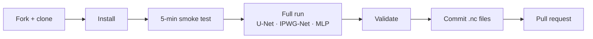

# Walkthrough: running one loss (example: `mae`)

This is the complete, start-to-finish path for running one loss. Replace `mae`
with any other loss everywhere; nothing else changes.

> **Current focus.** As decided in the meeting, the analysis currently focuses on three models: `basic_unet` (U-Net), `ipwg_net` (IPWG-Net) and `fully_connected` (pixel-wise MLP). The commands below therefore select them with `--models basic_unet,ipwg_net,fully_connected`; the other models in `models.toml` can be run the same way.




---

## 0. What you will produce

Six small NetCDF files (~10 kB each), two for each of the three models
(`basic_unet`, `ipwg_net`, `fully_connected`):

```
models/basic_unet/test_results/unet_gmi_gmi_gridded_m_mae_adamw_warmup_cosine_annealing_restarts_v00.nc
models/basic_unet/netcdf_metrics/unet_gmi_gmi_gridded_m_mae_adamw_warmup_cosine_annealing_restarts_v00.nc
models/ipwg_net/test_results/ipwg_net_…_mae_…_v00.nc
models/ipwg_net/netcdf_metrics/ipwg_net_…_mae_…_v00.nc
models/fully_connected/test_results/fully_connected_…_mae_…_v00.nc
models/fully_connected/netcdf_metrics/fully_connected_…_mae_…_v00.nc
```

The other models (`encoder_decoder`, `dense_encoder_decoder`,
`efficient_net_v2`, `convnext`, `ResNet`) produce the same pair of files when
they are run.

`test_results/*.nc` = scores on the Austria / CONUS / Korea test domains.
`netcdf_metrics/*.nc` = training curves. Model weights (`models/*.pt`) stay on
your machine and are git-ignored.

---

## 1. Fork and clone

On GitHub: open `https://github.com/yash-upase/satrain_loss` → **Fork**.

```bash
git clone https://github.com/<your-github-username>/satrain_loss.git   # YOUR fork
cd satrain_loss
git remote add upstream https://github.com/yash-upase/satrain_loss.git   # to pull updates later
```

## 2. Install

```bash
conda create -n satrain_loss python=3.11 -y
conda activate satrain_loss
pip install git+https://github.com/ipwgml/satrain      # the dataset package
pip install -e .                                        # this repo
python -c "import satrain_models, torch; print(torch.cuda.is_available())"   # should print True
```

Optional but recommended: `pytest tests/test_losses.py -q` (≈ 30 s, no data needed).

## 3. Create your branch

```bash
git checkout -b loss/mae
```

## 4. Look at your loss (nothing to edit)

```bash
cat loss_study/losses/mae.toml
```
```toml
name = "mae"
task = "regression"
description = "Mean absolute error (L1). Robust to outliers, estimates the conditional median."

[args]
```

`mae` has no arguments. For losses that do (e.g. `huber` → `delta`, `tweedie`
→ `p`, `weighted_mse` → `alpha`, `quantile` → `quantiles`) you may change the
`[args]` **before** you start and mention in the PR — then use the same
values for all models.

Everything else — dataset subset, optimizer schedule, epochs, precision,
batch sizes, model sizes — is fixed in `loss_study/compute.toml`,
`loss_study/dataset_*.toml` and `loss_study/models.toml`. **Do not edit those
files.** If a model does not fit on the GPU, please open an issue; the batch size
is then changed for every run, so that all runs stay comparable.

## 5. Smoke test (5 minutes)

Proves that data download, training, saving, evaluation and result writing
all work on your machine, using the tiny `xs` subset and 2 batches:

```bash
python loss_study/run_loss.py mae --models basic_unet --subset xs --max-epochs 1 --limit-batches 2 --devices 0
```

* `--devices 0` = GPU index (`0,1` for two GPUs; `cpu` works but evaluation is very slow).
* Output goes to `loss_study/logs/mae_basic_unet.log`.
* The run is tagged `loss_comparison_smoke`; such results are ignored by the
  study tooling, so they cannot pollute anything. You can delete them afterwards:

```bash
rm -f models/basic_unet/test_results/*_xs_mae_* models/basic_unet/netcdf_metrics/*_xs_mae_*
```

## 6. The actual/real run

```bash
python loss_study/run_loss.py mae --models basic_unet,ipwg_net,fully_connected --devices 0
```

That single command, for each of the three models:

1. `cd models/<model>` and runs
   `python train.py <model config> --dataset-config loss_study/dataset_*.toml --compute-config loss_study/compute.toml --loss loss_study/losses/mae.toml --batch-size <per-model> --study loss_comparison --devices 0`
2. then `python test.py models/<newest *_mae_*.pt> --compute-config loss_study/compute.toml --study loss_comparison --devices 0`

Useful variants:

```bash
python loss_study/run_loss.py mae --models ipwg_net --devices 1          # one model (e.g. on another GPU)
python loss_study/run_loss.py mae --models ipwg_net --skip-train         # re-run evaluation only
python loss_study/run_loss.py mae --devices 0                           # every model in models.toml
python loss_study/run_loss.py mae --dry-run                              # print the commands, run nothing
python loss_study/run_loss.py --list                                     # show the model matrix
```

If a model crashes, the runner prints `TRAIN FAILED … see loss_study/logs/mae_<model>.log`,
continues with the next model, and exits non-zero at the end. Fix the cause
(usually GPU memory) and re-run just that model. Re-runs get a
new version suffix (`_v01`); the newest one counts.

Watch progress with `tensorboard --logdir models/<model>/lightning_logs`.

## 7. Validate

```bash
python loss_study/validate_results.py models/*/test_results/*_mae_*.nc
```

Expected: one `OK` line per model and `3/3 files valid.` The checker verifies
the study tag, loss name, subset `m`, the fixed optimizer approach and epoch
count, and that all three domains have finite metrics. If something says
`FAIL`, the line below it tells you why (typically: run made with an override
flag, or a missing domain).

Have a look at your numbers if you like:

```bash
python - <<'PY'
import xarray as xr, glob
for f in sorted(glob.glob("models/*/test_results/*_mae_*.nc")):
    ds = xr.open_dataset(f)
    print(f"{f.split('/')[1]:22s}", "mae:", ds.mae.values.round(3), "corr:", ds.correlation_coef.values.round(3))
PY
```

## 8. Commit and push — only the result files

```bash
git status                      # should show only .nc files under models/*/test_results and models/*/netcdf_metrics
git add models/*/test_results/*_mae_*.nc models/*/netcdf_metrics/*_mae_*.nc
git commit -m "MAE loss results (U-Net, IPWG-Net, MLP)"
git push -u origin loss/mae
```

Do **not** add `.pt` weights, `checkpoints/`, `lightning_logs/` or any config
file (they are git-ignored, but check `git status` anyway).

## 9. Open the pull request

GitHub shows *"loss/mae had recent pushes — Compare & pull request"*. Target:
`yash-upase/satrain_loss`, branch `main`. The PR template asks to tick the
models that were run and confirm the checklist:

- [x] Ran via `python loss_study/run_loss.py mae` with no override flags
- [x] `loss_study/compute.toml`, `dataset_*.toml`, `models.toml` unchanged
- [x] `validate_results.py` passes
- [x] Only `.nc` result files included
- [x] `[args]` unchanged (or explained)

CI re-runs the validator on your files. Once CI is green and the PR is
reviewed, it is merged and your loss appears in `loss_study/results/leaderboard.md` next to the others.

## 10. Afterwards

```bash
git checkout main && git pull upstream main     # get everybody's results + the leaderboard
jupyter lab loss_study/notebooks/compare_losses.ipynb
```

---

## FAQ

**Do I have to touch any model code?** No. The loss is selected by name; the
model scripts read `loss.n_outputs` and `loss.predict` from the loss object.

**I want to add a loss that is not in `loss_study/losses/`.** See
`CONTRIBUTING.md`: subclass `satrain_models.losses.Loss`, register it, add a
TOML — about 15 lines.
